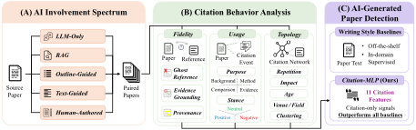
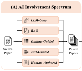
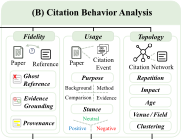
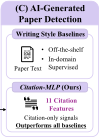
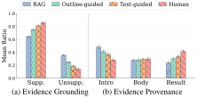
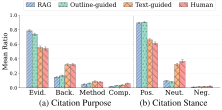
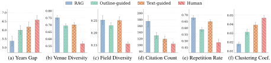

<div align="center">

<h1>CiteSpectrum</h1>

<h3>Show Me How You Cite: Citation Fidelity, Usage, and Topology<br>in the Evidence Behavior of AI Scientific Writing</h3>

<p><b>Tracing how AI uses scientific evidence, from model-only writing to human authorship.</b></p>

<p>Jihwan Oh &nbsp;·&nbsp; Gyeonghun Sun &nbsp;·&nbsp; Jisoo Kim &nbsp;·&nbsp; Yuho Lee &nbsp;·&nbsp; Taewon Yun &nbsp;·&nbsp; Jisu Shin &nbsp;·&nbsp; Hwanjun Song</p>

<p>Korea Advanced Institute of Science and Technology (KAIST) &nbsp;·&nbsp; Cluvion</p>

<p>

<a href="docs/paper.pdf"></a>
<a href="data/0hop"></a>
<a href="LICENSE"></a>
</p>

<p>
<a href="docs/paper.pdf"><b>Paper</b></a> &nbsp;·&nbsp;
<a href="data/0hop"><b>Browse data</b></a> &nbsp;·&nbsp;
<a href="https://github.com/DISL-Lab/CiteSpectrum/archive/refs/heads/main.zip"><b>Download</b></a> &nbsp;·&nbsp;
<a href="#quick-start"><b>Quick start</b></a>
</p>

<a href="assets/overview.pdf"></a>

<details>
<summary><b>Enlarged views of the study design</b></summary>
<p><a href="assets/overview-spectrum.pdf"></a></p>
<p><a href="assets/overview-analysis.pdf"></a></p>
<p><a href="assets/overview-detection.pdf"></a></p>
</details>

</div>

---

**CiteSpectrum** studies how scientific writing changes as AI involvement varies. Starting from the same 50 source surveys, we compare five writing conditions with **GPT-5.4** and **Qwen3-Next-80B-A3B-Instruct**, keeping source topics paired across the spectrum. We analyze citations through **fidelity**, **usage**, and **topology**, and show that these behaviors carry an interpretable signal for identifying AI-generated papers.

| Five writing conditions | Two model families | 450 unique surveys | 14 domains |
|:---:|:---:|:---:|:---:|
| From LLM-Only to Human-Authored | GPT-5.4 · Qwen3-Next-80B | 400 AI-involved + 50 human | Paired by source topic |

## The AI involvement spectrum

Each step adds a different form of guidance. The source topic stays fixed, so papers can be compared across conditions using the same source ID.

| Condition | What guides the writing? | GPT-5.4 | Qwen3-Next-80B |
|:---|:---|:---:|:---:|
| **LLM-Only** | Topic; the model supplies references, structure, and prose from parametric knowledge | [50 surveys](data/0hop/gpt54/llm-only) | [50 surveys](data/0hop/qwen80b/llm-only) |
| **RAG** | Topic and retrieved scholarly literature | [50 surveys](data/0hop/gpt54/rag) | [50 surveys](data/0hop/qwen80b/rag) |
| **Outline-Guided** | Human-authored outline and reference pool | [50 surveys](data/0hop/gpt54/outline-guided) | [50 surveys](data/0hop/qwen80b/outline-guided) |
| **Text-Guided** | Human-authored prose and reference pool; the model restores citations | [50 surveys](data/0hop/gpt54/text-guided) | [50 surveys](data/0hop/qwen80b/text-guided) |
| **Human-Authored** | Original human-authored survey | [50 surveys](data/0hop/gpt54/human-authored) | [50 surveys](data/0hop/qwen80b/human-authored) |

The **same 50 human surveys** appear under both model folders for convenient pairing. This gives **500 JSON files representing 450 unique surveys**, with source IDs `001`–`050` shared across all ten folders.

## What citation behavior reveals

We organize **11 citation-behavior feature groups** along three complementary dimensions.

| Dimension | Question | Feature groups |
|:---|:---|:---|
| **Fidelity** | Do references exist, and do they support the claims? | Ghost reference rate, evidence grounding, evidence provenance |
| **Usage** | What role does a citation play in the argument? | Citation purpose, citation stance |
| **Topology** | How are references selected, reused, and connected? | Reference age, venue diversity, field diversity, citation count, repetition, network clustering |

**Retrieval resolves fabricated references, but grounding still needs guidance.** Ghost reference rates fall from 79.2% in LLM-Only to 0.4% in RAG. Yet 36% of RAG citation instances remain unsupported, compared with 14% in Human-Authored writing.

**Human prose changes citation usage.** RAG and Outline-Guided writing cite predominantly as affirmative evidence. Text guidance brings citation purpose and stance closer to human writing, including a larger share of neutral citations.

<table>
<tr>
<td width="50%" align="center"><a href="assets/fidelity.pdf"></a><br><sub><b>Fidelity:</b> stronger guidance improves grounding.</sub></td>
<td width="50%" align="center"><a href="assets/usage.pdf"></a><br><sub><b>Usage:</b> human prose changes how evidence is used.</sub></td>
</tr>
</table>

**AI reference networks remain broader and less interconnected.** AI-involved surveys span more venues and fields and favor highly cited references, while human reference networks show stronger clustering. Text guidance only partially closes these structural gaps.

<p align="center"><a href="assets/topology.pdf"></a><br><sub>Figures reproduced from the paper. Click any figure to zoom in its vector PDF. <a href="assets/README.md">Download full-resolution figures.</a></sub></p>

## Citation-based AI paper detection

A lightweight **Citation-MLP** uses citation behavior to distinguish AI-involved from human-authored papers. In the paper's binary detection experiment, it achieves **0.880 balanced accuracy** and **0.944 AUROC**, outperforming all six text-based baselines.

| Method | Balanced accuracy | Macro-F1 | AUROC |
|:---|---:|---:|---:|
| Qwen3-80B-Inst. | 0.626 | 0.506 | 0.650 |
| Fast-DetectGPT | 0.611 | 0.542 | 0.674 |
| EditLens | 0.660 | 0.471 | 0.787 |
| Pangram | 0.844 | 0.731 | 0.816 |
| DistilBERT | 0.775 | 0.763 | 0.882 |
| Llama-3.2-3B | 0.793 | 0.792 | 0.924 |
| **Citation-MLP (Ours)** | **0.880** | **0.876** | **0.944** |

Results are from Table 4 of the [paper](docs/paper.pdf), using domain-balanced five-fold cross-validation on 350 AI-generated and 100 human-authored papers. This detection split combines survey and method papers; the release below contains the **0-hop survey subset**.

## Released data

The release contains **survey text at hop 0**: the focal survey's title, section headings, and prose, with in-text citation markers retained. Each survey is stored as a `survey_content.json` file.

| Resource | Location |
|:---|:---|
| GPT-5.4 surveys across all five conditions | [`data/0hop/gpt54/`](data/0hop/gpt54) |
| Qwen3-Next-80B surveys across all five conditions | [`data/0hop/qwen80b/`](data/0hop/qwen80b) |
| Model, condition, source ID, file path, and checksum for every survey | [`data/0hop/manifest.json`](data/0hop/manifest.json) |
| Data format and pairing guide | [`data/README.md`](data/README.md) |
| Full paper | [`docs/paper.pdf`](docs/paper.pdf) |

The full study covers **550 papers and 78,016 citation events**, including the survey and method subsets. This repository releases the **450-survey text subset**. See Appendix C of the paper for the full study's corpus construction and statistics.

## Quick start

Clone the repository; reading the JSON files requires only Python's standard library.

```bash
git clone https://github.com/DISL-Lab/CiteSpectrum.git
cd CiteSpectrum
```

Load one RAG survey:

```python
import json
from pathlib import Path

root = Path("data/0hop")
manifest = json.loads((root / "manifest.json").read_text(encoding="utf-8"))
record = next(
    row for row in manifest["surveys"]
    if row["model"] == "gpt54"
    and row["condition"] == "rag"
    and row["stable_source_id"] == 1
)
survey = json.loads((root / record["path"]).read_text(encoding="utf-8"))

print(survey["title"])
for subsection in survey["subsections"]:
    print(subsection["section_title"], "/", subsection["subsection_title"])
    print(subsection["content"])
```

Compare the same source topic across all five conditions:

```python
paired = {}
for row in manifest["surveys"]:
    if row["model"] == "gpt54" and row["stable_source_id"] == 1:
        paired[row["condition"]] = json.loads(
            (root / row["path"]).read_text(encoding="utf-8")
        )

print(sorted(paired))
# ['human-authored', 'llm-only', 'outline-guided', 'rag', 'text-guided']
```

<details>
<summary><b>Repository layout</b></summary>

```text
CiteSpectrum/
├── README.md
├── LICENSE
├── assets/                    # High-resolution figures and vector PDFs
├── docs/
│   └── paper.pdf
└── data/
    ├── README.md
    └── 0hop/
        ├── manifest.json
        ├── gpt54/
        │   ├── llm-only/
        │   ├── rag/
        │   ├── outline-guided/
        │   ├── text-guided/
        │   └── human-authored/
        └── qwen80b/            # Same five conditions
```

</details>

## Citation
